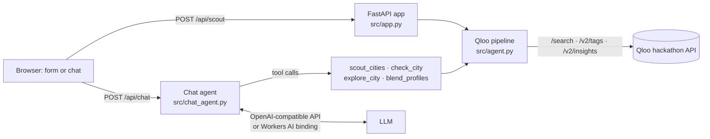

# 🧭 Relocation Scout: an agent with taste

Moving cities is one of the biggest lifestyle decisions people make, and most "best places to live" lists ignore what makes a place feel like *yours*.
Relocation Scout takes what you love (artists, films, shows, books, restaurants, brands, lifestyle keywords) and uses **Qloo's taste graph** to find the cities **and neighborhoods** whose cultural fabric matches you. It also explains *which* of your tastes pull you there.

Built for the [Qloo Agentic Hackathon](https://qloo.devpost.com/).

**Live demo: https://scout.taswar.dev** (Cloudflare Python Worker). Try a shared profile: <https://scout.taswar.dev/?music=Radiohead,Bon%20Iver&films=Lost%20in%20Translation&lifestyle=walkable&compare=Lisbon>

**Repo:** https://github.com/taswarshah/qloo-relocation-scout · **License:** MIT

## Contents
[Screenshots](#screenshots) · [Features](#features) · [How it works](#how-it-works) · [Prerequisites](#prerequisites) · [Run locally](#run-locally-step-by-step) · [Docker](#run-with-docker) · [Deploy](#deploy-to-cloudflare-workers-how-the-live-demo-runs) · [Tests](#tests-lint-and-checks) · [Usage guide](#usage-guide) · [API](#api-endpoints) · [Troubleshooting](#troubleshooting) · [Limitations](#limitations)

## Screenshots
| Home (desktop) | Taste form, filled from a preset |
|---|---|
|  |  |
| **Ask the scout (chat agent)** | **Mobile** |
|  |   |

**Why there are no result screenshots here:** Qloo's [hackathon developer guide](https://docs.qloo.com/reference/qloo-llm-hackathon-developer-guide) says: *"Do not store Qloo response data in a public repository — that makes the data publicly accessible outside the terms of your API key."* Result cards, city scores and chat answers are Qloo response data, so those screenshots are attached to the Devpost submission instead. To see them, open the [live demo](https://scout.taswar.dev/?music=Radiohead,Bon%20Iver&films=Lost%20in%20Translation&lifestyle=walkable&compare=Lisbon), or regenerate them locally with `python tests/ui/browser_check.py` (the `.gitignore` keeps `*results*` and `*compare*` screenshots out of git).

## Features
**Two ways to use it**
- **Ask the scout (conversational agent).** An LLM plans and calls Qloo-backed tools itself: `scout_cities`, `check_city` ("why not Lisbon?"), `explore_city` ("where in Reykjavik for great coffee?") and `blend_profiles` ("my partner loves Bad Bunny and beaches"). The LLM only plans and talks. Every city, score, neighborhood and venue it mentions comes from a tool result, and the UI shows each Qloo step it took. A code-level check enforces it: any score-like number in a reply that no Qloo tool returned sends the model back to the tools, and a reply that still can't be grounded is refused. Works with any OpenAI-compatible endpoint that supports tool calling (`LLM_*` env vars); the panel is hidden when none is configured.
- **The form.** The same Qloo pipeline as a deterministic one-shot flow, with no LLM needed.

**Couple and family mode.** `blend_profiles` resolves each person's tastes separately, ranks a candidate pool on the combined signals, then scores every candidate for each person alone (`filter.results.entities`). Cities are ordered by **the lower of the two scores**, so the result is a genuine compromise, not one person's list. Each card shows both people's affinity bars.

**More**
- **Compare two cities side by side:** tick any two result cards, including "your pick", to see real Qloo numbers only (no blended score): overall affinity, per-taste affinities, shared and unique cultural signals, neighborhood evidence and data coverage.
- **"Why not my city?":** enter a city you're already considering. It's scored on the same signals via `filter.results.entities`, and the agent explains the gap taste by taste.
- **Exact attribution:** per-taste affinities are fetched for exactly the shown cities (`filter.results.entities`), keyed by Qloo entity ID.
- **Coordinates instead of names for local venues:** `filter.location=POINT(lon lat)` + `filter.location.radius` (15 km, widening to 60 km for thin data). A name like "Flores" otherwise resolves to a Buenos Aires barrio.
- **Relevance filter:** hotels, B&Bs, wedding and event venues, supermarkets, schools, offices, gas stations, transit and address-like names are dropped using Qloo category tags (a hotel's restaurant or a hostel café stays). Spots are ranked by taste affinity.
- **Failure transparency:** per-endpoint counters (ok, retries, timeouts, HTTP errors, rate-limited). Responses carry `health.partial` and a safe warning shown in the UI, and an upstream outage returns 503 rather than "no matches".
- **Shareable links:** every search updates the URL with the profile (`?music=…&films=…&lifestyle=…&compare=…`), so a result can be shared or bookmarked and reopens with the same search.
- **Progress notes in chat:** "Checking cities on Qloo…", updated while long turns run.
- **Replies in the user's language** (for example Urdu), and requests that aren't about relocation (such as writing code) are declined.

## How it works


**Qloo endpoints used** (all against `https://hackathon.api.qloo.com`, key in the `X-Api-Key` header):
| Endpoint | Used for |
|---|---|
| `GET /search` | Turn each free-text taste into a Qloo entity (artist, movie, tv_show, person, place, brand); books resolve to their author |
| `GET /v2/tags` | Lifestyle words, dishes, cuisines and genres → destination genres and venue tags |
| `GET /v2/insights?filter.type=urn:entity:destination` | Rank cities, per-taste attribution, score a named city (`filter.results.entities`) |
| `GET /v2/insights?filter.type=urn:entity:place` | Taste-matched venues around a city (`filter.location` + radius), grouped into neighborhoods |

**Agent tools** (`src/chat_agent.py`): `scout_cities` (shortlist), `check_city` ("why not Lisbon?"), `explore_city` ("where in Reykjavik for coffee?"), `blend_profiles` (two people). Every city the user names is checked by code even if the model skips it; city and couple comparisons are written by code from tool results, and a reply with numbers no tool returned is sent back or refused.

### Pipeline in detail
1. **Resolve tastes:** `/search` maps each free-text like to a Qloo entity (artist, movie, tv_show, place, brand). The top results are checked against what you typed, so gibberish or a near-miss ("zzqxv qwerty" → the band Qwerty) is reported as *not found* instead of silently steering results. Books are resolved to their **author as a person entity**, because Qloo rejects books as destination signals. Lifestyle words ("walkable", "nightlife", "hiking") become **filters**: a Qloo destination genre (`urn:tag:genre:destination:*`) and venue tags from `/v2/tags?filter.parents.types=urn:entity:place`. We measured that tags passed as `signal.interests.tags` don't change Qloo's ranking (same order, scores only shift), so they are applied as `filter.tags` instead.
2. **Find cities:** `/v2/insights?filter.type=urn:entity:destination` with the entity signals, narrowed by the lifestyle genres (any of them; it falls back to the full ranking if that leaves too few), optionally `filter.geocode.country_code`. The shortlist is spread across regions (one per state, two per country, nothing within 80 km of another pick). Two spare cities are scored in the same calls: if Qloo's coordinates for a pick point to a different town (e.g. "Doolin" pinned to Pottstown, PA, where no venue address mentions Doolin), it is skipped and the trace says so.
3. **Attribute:** one destination-insights call per taste, so each city gets a "strongest pull" breakdown (for example, Pittsburgh is driven by Lost in Translation 86, Bon Iver 85 and Amélie 80).
4. **Zoom into neighborhoods:** `/v2/insights?filter.type=urn:entity:place` around the city's coordinates (`filter.location` + radius) with the same signals, narrowed to your lifestyle's venue tags (cafés, hiking areas, coworking spaces…) when enough match nearby. Administrative neighborhood prefixes are cleaned before grouping. Accent-insensitive address/geocode checks reject contradictory locality or country evidence; missing evidence is retained, not treated as proof of location. Common country names in addresses are recognized conservatively. Mood and character tags (ambience, setting, neighborhood character, decor) become a "local vibe" summary; amenities, payments, service options and meal times are excluded. When neighborhood detail is missing, the additive `top_spots` list provides up to four distinct taste-matched venues, ranked by affinity (response order breaks ties), and the explanation mentions them.
5. **Explain:** grounded explanations are built only from Qloo data. The conversational agent (`src/chat_agent.py`) wraps these steps as tools; its system prompt forbids inventing places or scores, and tool results are its only facts.

Every response includes an **agent trace** of the Qloo calls it made.

### Performance
Three parallel rounds of Qloo calls (resolve, then rank and attribute, then neighborhoods). Bounded concurrency (`QLOO_CONCURRENCY`, default 6), a pooled keep-alive HTTP client, a lock-free pacer matched to the key's 5 req/s limit (`QLOO_RATE_PER_S`) with a wait-until-reset retry on 429, runs that finish even if the client disconnects (Workers `waitUntil`), so an abandoned request can't block the next one, and a private in-memory TTL cache (`QLOO_CACHE_TTL_S`, `QLOO_CACHE_MAX`). Measured with a cold cache across the 10 eval personas: p50 6.2 s, max 7.6 s (see [eval/RESULTS.md](eval/RESULTS.md) for the latest run). Cached repeats take under 50 ms. Every response includes a `timings` object.

### Data quality
Neighborhood names are cleaned of administrative prefixes. Venues whose address or geocode contradicts the city or country are dropped (US territories count as US). Destinations within 30 km of each other are merged. Amenity, numeric and COVID-era tags are filtered out of the vibe. Cities without neighborhood labels fall back to top taste-matched spots.

## Prerequisites
- **Python 3.12+** (`pyproject.toml`; Docker uses `python:3.12-slim`; tested here on 3.13).
- **A Qloo hackathon API key** — request it via the [developer guide](https://docs.qloo.com/reference/qloo-llm-hackathon-developer-guide#getting-your-api-key). It only works against `https://hackathon.api.qloo.com`.
- **Optional, for the chat agent:** an OpenAI-compatible `/chat/completions` endpoint with tool calling (`LLM_API_KEY`, `LLM_BASE_URL`, `LLM_MODEL`). Without them the chat panel is hidden and the form works on its own. The live demo instead uses the Cloudflare Workers AI binding (`@cf/mistralai/mistral-small-3.1-24b-instruct`), so it needs no LLM key.
- Optional: Docker; Node.js + `uv` for Cloudflare deploys.

## Run locally (step by step)
```bash
# 1. Clone
git clone https://github.com/taswarshah/qloo-relocation-scout.git
cd qloo-relocation-scout

# 2. Virtual environment and dependencies
python3 -m venv .venv
. .venv/bin/activate            # Windows: .venv\Scripts\activate
pip install -r requirements-server.txt

# 3. Configure
cp .env.example .env
#   set QLOO_API_KEY=<your hackathon key>
#   optional: LLM_API_KEY / LLM_BASE_URL / LLM_MODEL to enable "Ask the scout"

# 4. Run
uvicorn --app-dir src app:app --port 8077
#   or, with interactive API docs at http://localhost:8077/docs:
ENV=development uvicorn --app-dir src app:app --port 8077

# 5. Open http://localhost:8077 and click a preset, then "Find my cities"
```
Quick check: `curl localhost:8077/healthz` → `{"ok":true}`; `curl localhost:8077/api/config` → `{"chat":true}` when the LLM vars are set.

**Environment variables** (from `.env.example` and the code):
| Variable | Default | Purpose |
|---|---|---|
| `QLOO_API_KEY` | — (required) | Qloo hackathon key |
| `QLOO_BASE_URL` | `https://hackathon.api.qloo.com` | Qloo API base |
| `LLM_API_KEY`, `LLM_BASE_URL`, `LLM_MODEL` | empty | Enable the chat agent (all three needed locally) |
| `ENV` | `production` | `development` enables `/docs` |
| `QLOO_CONCURRENCY` | `6` | Parallel Qloo calls |
| `QLOO_RATE_PER_S` | `4.5` | Client-side pacing to the key's rate limit |
| `QLOO_CACHE_TTL_S` / `QLOO_CACHE_MAX` | `3600` / `2000` | In-memory response cache |
| `RATE_LIMIT_PER_MIN` | `12` | Per-IP request limit (local/Docker) |
| `MAX_CONCURRENT_SCOUTS` | `3` | Concurrent scout/chat runs |
| `SCOUT_TIMEOUT_S` / `CHAT_TIMEOUT_S` | `60` / `90` | Request timeouts |
| `TRUST_PROXY_HEADERS` | `0` | Trust `cf-connecting-ip`/forwarded headers behind a proxy |

## Run with Docker
```bash
docker build -t scout .
docker run -p 8080:8080 --env-file .env scout
# open http://localhost:8080
```
The image runs as a non-root user; secrets come from `--env-file` at runtime and are never baked in.

## Deploy to Cloudflare Workers (how the live demo runs)
The same FastAPI app runs as a [Python Worker](https://developers.cloudflare.com/workers/languages/python/) (`src/entry.py`). `wrangler.toml` builds static assets with `scripts/build_site.py` (into `.site/`, with the app's security headers), binds Workers AI as `AI`, sets `LLM_MODEL`, `ENV`, `QLOO_BASE_URL` and `TRUST_PROXY_HEADERS` as vars, and defines three edge rate limiters (10 scouts/min per IP, 6 chat turns/min per IP, 12 chat turns/min globally).
```bash
# 1. Tools: Node.js (for npx wrangler) and uv
npx wrangler login
# 2. Secret (never in wrangler.toml)
npx wrangler secret put QLOO_API_KEY
# 3. Edit `routes` in wrangler.toml for your own domain (or remove it and use workers.dev)
# 4. Deploy: builds .site/ and bundles src/ with Pyodide deps
uv run pywrangler deploy
```
Pyodide has no threads, so every endpoint is `async def` (a test enforces this).

## Tests, lint and checks
```bash
pip install -r requirements-dev.txt ruff
pytest -q                       # 227 offline tests, Qloo and the LLM mocked
ruff check .                    # lint
bandit -q -r src                # security lint (also in CI)
pip-audit -r requirements-server.txt
python tests/live_personas.py   # 3 personas end-to-end against live Qloo (needs QLOO_API_KEY)
python eval/run_eval.py         # live evaluation, writes eval/RESULTS.md
python tests/ui/browser_check.py  # Playwright + Chrome UI check on localhost, regenerates screenshots
```
CI (`.github/workflows/ci.yml`) runs pytest, pip-audit, bandit and gitleaks on every push.

### Evaluation
`python eval/run_eval.py` runs 10 synthetic personas (plus a perturbed version of each) against live Qloo and writes aggregate metrics to [eval/RESULTS.md](eval/RESULTS.md): coverage, relevance proxies, automated explanation grounding, sensitivity and latency. With `LLM_*` set it also runs an **LLM-only baseline** (same model, same personas, no Qloo) and compares how generic the picks are across personas, how much they react to taste changes, and how they score on Qloo's graph.

## Usage guide
1. **Form search.** Fill any fields (music, films, TV, books, restaurants & cafés, brands, lifestyle), comma-separated, and click **Find my cities**. Or click a preset: *Indie creative*, *Foodie & nightlife*, *Outdoorsy family · US*, *Tech & remote*. Each result card shows the affinity score, which of your tastes pull hardest, Qloo tags, neighborhoods or top spots, the local vibe, and "matched" chips showing what each taste resolved to.
2. **Country filter.** Enter a two-letter code (`US`, `PT`, `DE`) to stay in one country.
3. **"Why not my city?"** Put a city in *Already considering a city?* (e.g. Lisbon). It's scored on the same signals and shown next to your top pick with the gap explained taste by taste.
4. **Compare side by side.** Tick any two result cards to compare their real Qloo numbers.
5. **Ask the scout (chat).** Examples:
   - `I love Radiohead and Lost in Translation. Why not Lisbon?`
   - `I love Kendrick Lamar and sushi. How do Toronto and Melbourne compare?`
   - `Compare Paris, Berlin, Tokyo, Austin and Mexico City for someone who loves Mozart.`
   - `Where in Reykjavik for great coffee?`
   - Couple mode: `I love Radiohead and Lost in Translation. My partner loves Bad Bunny and tacos. Where should we both live?` (the partner can be named first too)
6. **Share.** Copy the URL after a search, e.g. <https://scout.taswar.dev/?music=Radiohead,Bon%20Iver&films=Lost%20in%20Translation&lifestyle=walkable&compare=Lisbon>.

## API endpoints
| Method | Path | Body / response |
|---|---|---|
| `POST` | `/api/scout` | `{"music","films","tv","books","food","brands","lifestyle"}` (comma-separated strings, ≤400 chars each), `"country"` (2 letters), `"compare"` (city, ≤60 chars). Returns cities, attribution, neighborhoods, `trace`, `timings`, `health`. 422 bad input, 429 rate limit, 503 busy/Qloo down, 504 timeout |
| `POST` | `/api/chat` | `{"messages":[{"role":"user","content":"…"}], "profile":{…}}` (≤600 chars per message, short history). 501 if no LLM is configured |
| `GET` | `/api/config` | `{"chat": true}` or `{"chat": false}` |
| `GET` | `/healthz` | `{"ok": true}` |
| `GET` | `/docs` | OpenAPI UI, only with `ENV=development` |

Example:
```bash
curl -s localhost:8077/api/scout -H 'content-type: application/json' \
  -d '{"music":"Radiohead, Bon Iver","films":"Lost in Translation","lifestyle":"walkable","compare":"Lisbon"}'
```

## Troubleshooting
| Symptom | Fix |
|---|---|
| 503 with "couldn't read your tastes" / trace shows `http_errors` on `/search` | Check `QLOO_API_KEY`, and that `QLOO_BASE_URL` is `https://hackathon.api.qloo.com` (hackathon keys return 401 on other hosts) |
| No "Ask the scout" panel; `/api/chat` returns 501 | Set all three `LLM_API_KEY`, `LLM_BASE_URL`, `LLM_MODEL` and restart |
| 429 *Too many requests* | Wait a minute or raise `RATE_LIMIT_PER_MIN` locally |
| 503 *Busy right now* | More than `MAX_CONCURRENT_SCOUTS` runs at once; retry |
| A taste shows as *not found* | Use a specific name (a film or artist rather than a genre); Qloo rejects some entries as signals |
| `/docs` is 404 | Start with `ENV=development` |
| Chat takes 15–30 s | Normal for multi-city questions; progress notes show while it works |

## Limitations
- **Cultural affinity only.** Qloo has no cost-of-living, safety, climate or visa data; the app says so instead of guessing.
- **Coverage follows Qloo's data.** Some cities aren't in Qloo's destinations (e.g. Karachi; Lahore and Islamabad are). Small towns (e.g. Mdina, Salem) can appear because Qloo ranks them highly and gives no population data.
- Neighborhood names, vibe tags and "start in" areas come straight from Qloo and are sometimes imprecise; some entities resolve imperfectly (e.g. "Breaking Bad" can match a documentary about the show).
- Chat needs an LLM; the live demo's Workers AI free allocation covers roughly 95 turns a day.
- Cache is in memory only, so it resets on restart.

## Cost
Hosting runs on Cloudflare Workers; the chat agent uses Workers AI (`@cf/mistralai/mistral-small-3.1-24b-instruct`) through a binding, so there is no external LLM key. A chat turn measures about **105 neurons** (2 LLM calls, ~3k prompt tokens), so Workers AI's daily free allocation covers roughly 95 turns. Edge rate limits (6 chat turns/min per IP, 12/min globally) bound the worst case. The form flow uses no LLM at all, and Qloo responses are cached in memory, so repeat scouts make zero Qloo calls.

**Why this model:** a live 5-turn test checked every number in each reply against the tool outputs. Mistral Small 3.1 had 0 ungrounded numbers and correct tool use; Llama 4 Scout wrote tool calls as text, and gpt-oss-120b invented 10 of 19 numbers. As a guard, any reply that writes a tool call as text is retried once and then refused.

## Project layout
`src/agent.py` (Qloo pipeline: scout, blend, spots) · `src/chat_agent.py` (LLM tool-use loop) · `src/app.py` (FastAPI, security) · `src/entry.py` (Worker entrypoint) · `scripts/build_site.py` (static assets for Workers) · `static/` (frontend) · `eval/` (live evaluation and LLM-only baseline) · `tests/` (offline tests, live personas, UI check) · `docs/screenshots/` (README images).

## Notes
- Qloo responses are cached in memory only. No Qloo data is stored in this repo, as the hackathon terms require.
- Requests are rate-limited (edge limits, a self-expiring concurrency cap, and 429 backoff).
- Third-party credits: Qloo Insights API, FastAPI, httpx; DM Sans and Manrope fonts (SIL Open Font License, self-hosted); Lucide icons (ISC); hero photo of Manarola from Unsplash (Unsplash License).

## Security
See [SECURITY.md](SECURITY.md): input limits, rate limiting, CSP, no secrets or Qloo data in the repo, and CI running pytest, pip-audit, bandit and gitleaks.

## License
[MIT](LICENSE)
