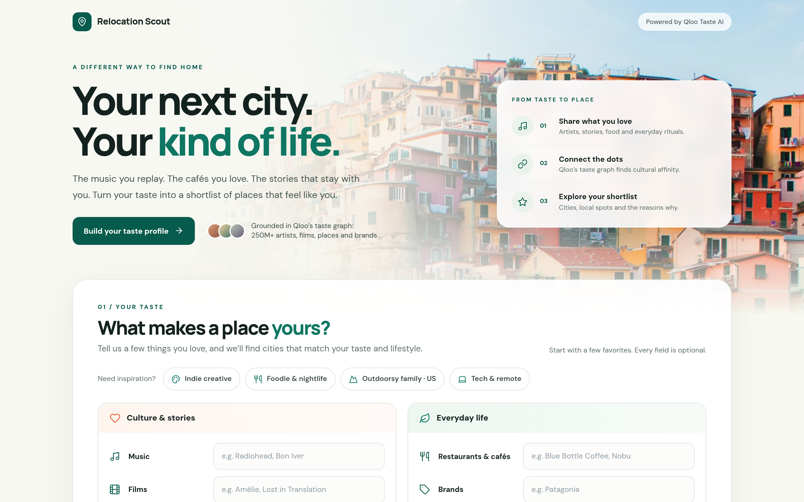
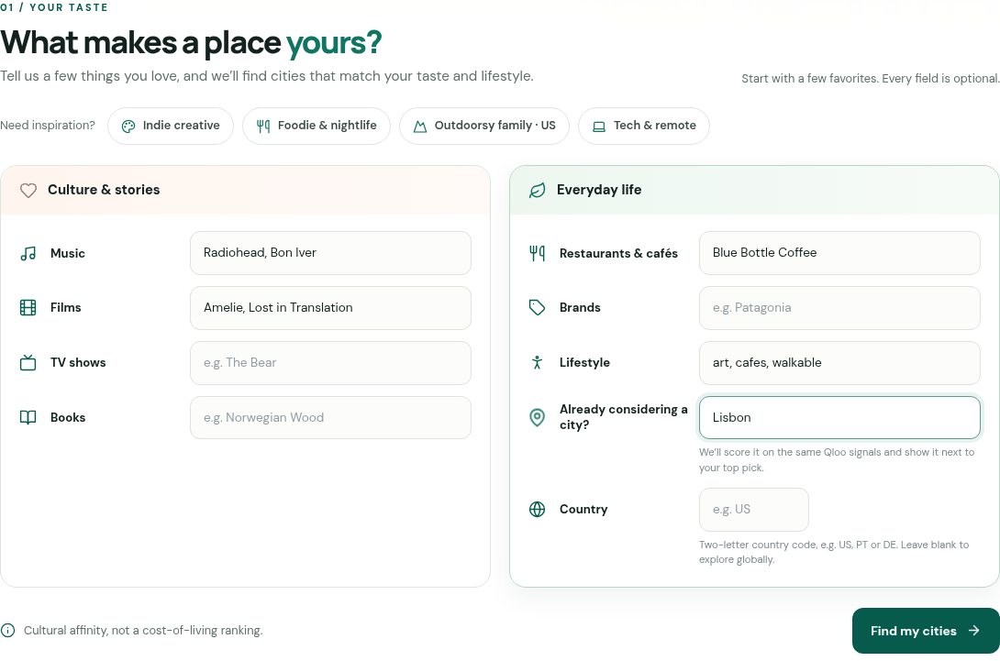
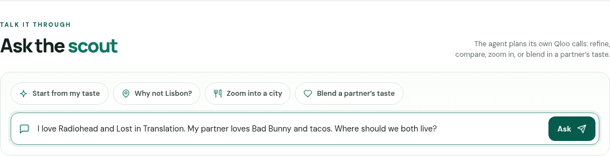
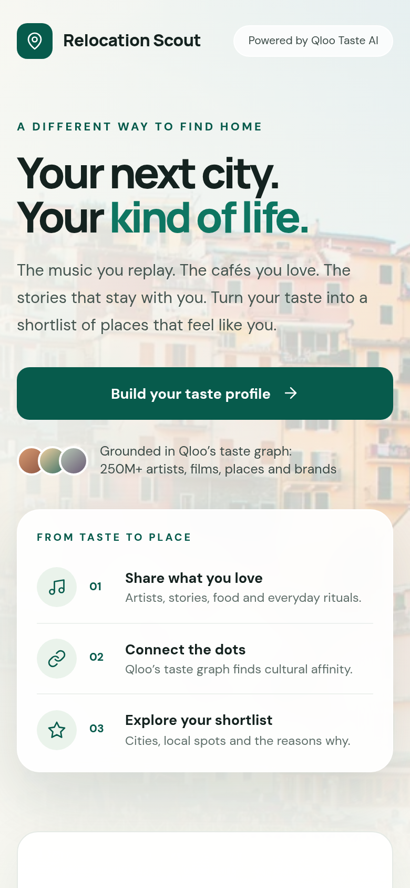
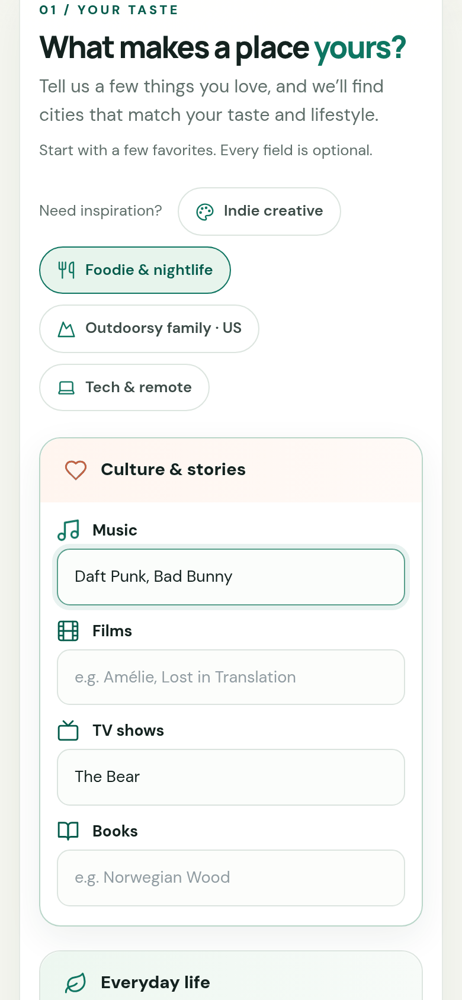
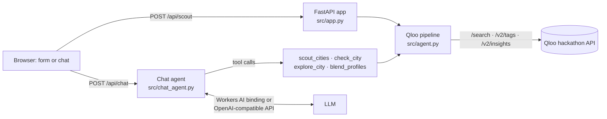

# 🧭 Relocation Scout: an agent with taste

Most "best places to live" lists rank rent and weather, so everyone gets the same shortlist. Relocation Scout starts from what you love (artists, films, shows, books, restaurants, brands, lifestyle words) and uses **Qloo's taste graph** to find the cities **and neighborhoods** where your kind of life already exists, and shows *which* of your tastes pull you there.

Built for the [Qloo Agentic Hackathon](https://qloo.devpost.com/).

**Live demo: https://scout.taswar.dev** · Try a shared profile: <https://scout.taswar.dev/?music=Radiohead,Bon%20Iver&films=Lost%20in%20Translation&lifestyle=walkable&compare=Lisbon>

**Repo:** https://github.com/taswarshah/qloo-relocation-scout · **License:** MIT

## Contents
[Screenshots](#screenshots) · [Features](#features) · [How it works](#how-it-works) · [Run locally](#run-locally) · [Docker](#run-with-docker) · [Deploy](#deploy-to-cloudflare-workers) · [Tests](#tests-and-evaluation) · [Usage](#usage) · [API](#api) · [Troubleshooting](#troubleshooting) · [Limitations](#limitations)

## Screenshots
| Home (desktop) | Taste form, filled from a preset |
|---|---|
|  |  |
| **Ask the scout (chat agent)** | **Mobile** |
|  |   |

Result screenshots are attached to the Devpost entry instead: Qloo's [hackathon guide](https://docs.qloo.com/reference/qloo-llm-hackathon-developer-guide) asks that Qloo response data not be stored in a public repo. Open the [live demo](https://scout.taswar.dev/?music=Radiohead,Bon%20Iver&films=Lost%20in%20Translation&lifestyle=walkable&compare=Lisbon) to see results.

## Features
- **Taste-matched shortlist.** Cities ranked by Qloo affinity (0–100), each with the tastes that drive its score, Qloo tags, neighborhoods to start in, taste-matched venues and the local vibe.
- **"Why not my city?"** Score a city you're already considering and see the gap to your top pick, taste by taste.
- **Ask the scout (chat agent).** An LLM plans and calls Qloo-backed tools: `scout_cities`, `check_city`, `explore_city` and `blend_profiles`. Every city, score and venue comes from a tool result, and the UI shows each Qloo step.
- **Couple and family mode.** Each person is scored separately and cities are ranked by the *lower* of the two scores, so neither person is settling.
- **Compare side by side.** Tick any two cards to compare real Qloo numbers (no invented composite score).
- **Honest by design.** Favorites Qloo doesn't recognize are shown as *not found* instead of guessed. A score no Qloo tool returned is never shown, and comparisons are written from Qloo data. Questions about cost, safety or visas get a plain "Qloo doesn't cover that".
- **Shareable links**, progress notes in chat, and replies in the user's language.

## How it works


| Qloo endpoint | Used for |
|---|---|
| `GET /search` | Turn each favorite into a Qloo entity (books resolve to their author) |
| `GET /v2/tags` | Lifestyle words, dishes and genres → destination genres and venue tags |
| `GET /v2/insights` (`filter.type=urn:entity:destination`) | Rank cities, attribute each taste, score a named city (`filter.results.entities`) |
| `GET /v2/insights` (`filter.type=urn:entity:place`) | Taste-matched venues around each city (`filter.location` + radius), grouped into neighborhoods |

**Pipeline:**
1. **Resolve** each favorite and check that the match is close to what you typed.
2. **Rank** cities on your taste signals, with lifestyle words applied as filters. The shortlist is spread across regions.
3. **Attribute** each city's score to your individual tastes.
4. **Find venues** around each city's coordinates and group them into neighborhoods.
5. **Explain** using only Qloo data.

Every response includes an agent trace of the Qloo calls and timings.

**Performance:** parallel rounds of Qloo calls, paced to the key's 5 req/s limit, with a private in-memory cache. A cold search takes about 6 s (p50) and a cached repeat under 50 ms.

## Run locally
Requires **Python 3.12+** and a **Qloo hackathon API key** ([how to get one](https://docs.qloo.com/reference/qloo-llm-hackathon-developer-guide#getting-your-api-key)).

```bash
git clone https://github.com/taswarshah/qloo-relocation-scout.git
cd qloo-relocation-scout
python3 -m venv .venv && . .venv/bin/activate      # Windows: .venv\Scripts\activate
pip install -r requirements-server.txt
cp .env.example .env                               # set QLOO_API_KEY (and optionally LLM_*)
uvicorn --app-dir src app:app --port 8077
```
Open http://localhost:8077, click a preset, then **Find my cities**. Check it's up with `curl localhost:8077/healthz` → `{"ok":true}`.

| Variable | Default | Purpose |
|---|---|---|
| `QLOO_API_KEY` | required | Qloo hackathon key |
| `QLOO_BASE_URL` | `https://hackathon.api.qloo.com` | Qloo API base |
| `LLM_API_KEY`, `LLM_BASE_URL`, `LLM_MODEL` | empty | Enable the chat agent locally (any OpenAI-compatible endpoint with tool calling). Without them the form still works and the chat panel is hidden |
| `ENV` | `production` | `development` enables `/docs` |
| `RATE_LIMIT_PER_MIN` | `12` | Per-IP request limit |

## Run with Docker
```bash
docker build -t scout .
docker run -p 8080:8080 --env-file .env scout     # open http://localhost:8080
```

## Deploy to Cloudflare Workers
The live demo runs the same FastAPI app as a [Python Worker](https://developers.cloudflare.com/workers/languages/python/). The chat uses the Workers AI binding (`@cf/mistralai/mistral-small-3.1-24b-instruct`), so no LLM key is needed. Edge rate limits protect the Qloo quota.
```bash
npx wrangler login
npx wrangler secret put QLOO_API_KEY
# edit `routes` in wrangler.toml for your domain, or remove it to use workers.dev
uv run pywrangler deploy
```

## Tests and evaluation
```bash
pip install -r requirements-dev.txt ruff
pytest -q                       # 227 offline tests (Qloo and the LLM mocked)
ruff check .
python eval/run_eval.py         # live evaluation, writes eval/RESULTS.md
```
CI runs pytest, pip-audit, bandit and gitleaks on every push.

**Evaluation:** [eval/RESULTS.md](eval/RESULTS.md) compares Scout with the same LLM *without* Qloo across 10 personas:

| Measure | Scout (Qloo) | LLM only |
|---|---|---|
| Distinct cities across personas (higher = more personal) | 33/38 | 27/40 |
| Share of picks taken by the 5 most common cities (lower = less generic) | 26% | 35% |
| Overlap after changing a persona's tastes (lower = responds to taste) | 0.17 | 0.23 |
| Explanation claims backed by Qloo data | 444/444 | not checkable |

## Usage
1. **Form:** fill a few favorites (comma-separated) or pick a preset, then **Find my cities**. Add a two-letter country code to stay in one country.
2. **Why not my city?** Enter a city under *Already considering a city?*
3. **Compare:** tick two result cards.
4. **Chat** examples:
   - `I love Radiohead and Lost in Translation. Why not Lisbon?`
   - `I love Kendrick Lamar and sushi. How do Toronto and Melbourne compare?`
   - `Where in Reykjavik for great coffee?`
   - `I love Radiohead. My partner loves Bad Bunny and tacos. Where should we both live?`
5. **Share:** copy the URL after a search.

## API
| Method | Path | Notes |
|---|---|---|
| `POST` | `/api/scout` | `{"music","films","tv","books","food","brands","lifestyle"}` as comma-separated strings, plus `"country"` (2 letters) and `"compare"` (a city). Returns cities, attribution, neighborhoods, `trace`, `timings` |
| `POST` | `/api/chat` | `{"messages":[{"role":"user","content":"…"}], "profile":{…}}`. Returns 501 if no LLM is configured |
| `GET` | `/api/config` | `{"chat": true \| false}` |
| `GET` | `/healthz` | `{"ok": true}` |

```bash
curl -s localhost:8077/api/scout -H 'content-type: application/json' \
  -d '{"music":"Radiohead, Bon Iver","films":"Lost in Translation","compare":"Lisbon"}'
```

## Troubleshooting
| Symptom | Fix |
|---|---|
| Every search says Qloo isn't responding | Check `QLOO_API_KEY` and that `QLOO_BASE_URL` is `https://hackathon.api.qloo.com` |
| No chat panel / `/api/chat` returns 501 | Set `LLM_API_KEY`, `LLM_BASE_URL` and `LLM_MODEL`, then restart |
| A favorite shows as *not found* | Use a specific name (an artist or film rather than a genre) |
| 429 *Too many requests* | Wait a minute |

## Limitations
- **Cultural fit only.** Qloo has no cost-of-living, safety, climate or visa data, and the app says so instead of guessing.
- **Coverage follows Qloo's data.** Some cities aren't in it (e.g. Karachi), small towns can rank highly, and some entries can't be used as signals (they're reported as not found).
- Neighborhood names and vibe tags come straight from Qloo and are sometimes imprecise.

## Project layout
`src/agent.py` (Qloo pipeline) · `src/chat_agent.py` (agent loop) · `src/app.py` (API and security) · `src/entry.py` (Worker entry) · `static/` (frontend) · `eval/` (evaluation and LLM-only baseline) · `tests/`

## Credits and security
Qloo Insights API, FastAPI, httpx; DM Sans and Manrope fonts (SIL OFL); Lucide icons (ISC); hero photo of Manarola from Unsplash. No secrets or Qloo data are stored in the repo; see [SECURITY.md](SECURITY.md).

## License
[MIT](LICENSE)
